# TCP vs UDP Performance Comparison - Project Report

_Generated 2026-10-21 19:10 from `results_full.csv` on Darwin arm64,
Python 3.14.0. Emulation mode: **software**._

## 1. Objective

Measure and compare TCP and UDP on **throughput, delay (RTT), jitter, packet loss, reliability (delivery
ratio, ordering, duplicates)** and completion time under controlled network conditions (loss, delay,
bandwidth limits, concurrency), and derive data-backed recommendations for which transport suits which
class of application (QoS).

## 2. Architecture

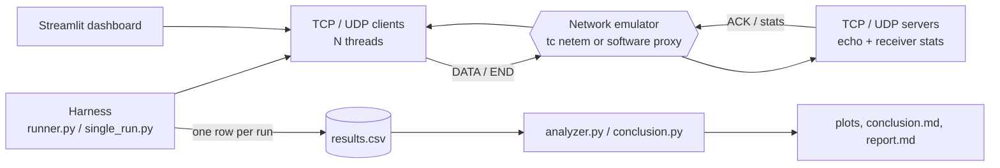

* **common/** - shared packet format (`protocol.py`: 4 B seq, 8 B send timestamp ns, 2 B length, 1 B flags +
  random payload; TCP adds a 4 B length prefix), metrics (`metrics.py`), configuration (`config.py`).
* **tcp/, udp/** - threaded echo servers and multi-client load generators. The server ACKs every DATA
  packet (header only, original seq + timestamp, so the client gets RTT) and keeps receiver statistics,
  returned as JSON in reply to the END packet. UDP retries END until it gets the statistics back.
* **netem/** - `netem.sh` + `netem_py.py` drive Linux `tc qdisc ... netem`; `emulator.py` is a software
  impairment proxy used when netem is unavailable; `environment.py` picks the mode and guarantees cleanup.
* **harness/** - `single_run.py` (one test), `runner.py` (matrix, `--quick/--full/--resume`), CSV logging.
* **analysis/** - statistics/plots, the auto-conclusion and this report. **dashboard/** - Streamlit UI.

## 3. Methodology

1. TCP and UDP servers run as separate processes; for every run the emulator (or netem) is configured,
   N client threads send `num_packets` packets of `packet_size` bytes at a fixed packet rate, then END.
2. **Throughput** = bytes received by the server / receiver active window (first to last arrival);
   **goodput** counts unique payload bytes only. **RTT** = ACK arrival - send timestamp (client clock);
   avg/min/max/p50/p95/p99 over all ACKs. **One-way delay** = server arrival - send timestamp (valid
   because client and server share a clock on loopback). **Jitter** follows RFC 3550
   (J += (|D| - J)/16). **Loss** = (sent - unique received) / sent using sequence gaps plus the sent
   count carried in END; **delivery ratio** = 100 - loss; duplicates and out-of-order arrivals are
   counted per session. TCP **retransmissions** come from `/proc/net/snmp` (Linux) or `netstat -s`
   (macOS) deltas in netem mode, or from the emulator's loss-event count in software mode.
3. **Emulation.** netem on `lo` impairs every packet in both directions (RTT = 2 x delay). The software
   emulator reproduces that per direction: random loss, delay + uniform jitter (UDP may reorder),
   a shared rate-limited link with a 100-packet tail-drop queue. Because a proxy
   cannot drop bytes from a TCP stream, a TCP loss event stalls the stream by one RTT +
   25 ms (retransmission / head-of-line blocking) and halves a Reno-style
   congestion window (initial 10 segments) that paces the connection at
   cwnd x MSS / RTT.
4. Each combination is repeated; tables and plots show the mean, error bars the standard deviation.
   Plots vary one factor while the others sit at the baseline (1024 B, 0% loss, 0 ms, unlimited,
   1 client) when such runs exist; otherwise they average over the other factors.

## 4. Test matrix

| Factor                    | Levels                             |
|:--------------------------|:-----------------------------------|
| Protocol                  | TCP, UDP                           |
| Packet size (B)           | 64, 512, 1024, 1400                |
| Loss (%)                  | 0, 1, 5, 10                        |
| One-way delay (ms)        | 0, 50, 200 (jitter = 10% of delay) |
| Bandwidth                 | unlimited, 10 Mbps, 1 Mbps         |
| Concurrent clients        | 1, 5, 10                           |
| Repeats per combo         | 3 (full) / 2 (quick)               |
| Packets per client / rate | 200 @ 1000 pps                     |

This report covers **855 successful runs** over **855 combinations** (repeats per combination:
min 1, max 1).

## 5. Results

### 5.1 Overall means by protocol

|                    |      TCP |     UDP |
|:-------------------|---------:|--------:|
| throughput_mbps    |    6.329 |  12.042 |
| goodput_mbps       |    6.145 |  11.756 |
| rtt_avg_ms         | 2312.89  | 294.833 |
| rtt_p95_ms         | 5627.84  | 390.925 |
| jitter_ms          |   44.005 |   8.57  |
| loss_pct           |    0     |  35.057 |
| delivery_ratio_pct |  100     |  64.943 |
| out_of_order       |    0     | 234.431 |
| duplicates         |    0     |   0     |
| completion_time_s  |    6.473 |   2.872 |

### 5.2 Throughput (Mbps) over the loss x delay grid

|          |   TCP d=0ms |   UDP d=0ms |   TCP d=50ms |   UDP d=50ms |   TCP d=200ms |   UDP d=200ms |
|:---------|------------:|------------:|-------------:|-------------:|--------------:|--------------:|
| loss 0%  |        8.29 |        8.27 |         7.44 |         8.08 |          1.79 |          7.12 |
| loss 1%  |        8.3  |        8.12 |         3.5  |         7.99 |          0.27 |          7.42 |
| loss 5%  |        8.05 |        8.12 |         0.64 |         7.75 |          0.22 |          7.27 |
| loss 10% |        7.25 |        7.78 |         0.7  |         7.09 |          0.15 |          6.24 |

### 5.3 Mean RTT (ms) over the loss x delay grid

|          |   TCP d=0ms |   UDP d=0ms |   TCP d=50ms |   UDP d=50ms |   TCP d=200ms |   UDP d=200ms |
|:---------|------------:|------------:|-------------:|-------------:|--------------:|--------------:|
| loss 0%  |        0.21 |        0.24 |       166.3  |       100.75 |        941.32 |        400.4  |
| loss 1%  |        8.29 |        0.24 |       268.32 |       100.2  |       3713.21 |        399.41 |
| loss 5%  |       15    |        0.23 |      1246.14 |       100.75 |       4096.2  |        402.54 |
| loss 10% |       28.1  |        0.25 |      1302.03 |       100.72 |       5092.29 |        399.04 |

### 5.4 Measured loss (%) over the loss x delay grid

|          |   TCP d=0ms |   UDP d=0ms |   TCP d=50ms |   UDP d=50ms |   TCP d=200ms |   UDP d=200ms |
|:---------|------------:|------------:|-------------:|-------------:|--------------:|--------------:|
| loss 0%  |           0 |         0   |            0 |          0   |             0 |           0   |
| loss 1%  |           0 |         1.5 |            0 |          0   |             0 |           0.5 |
| loss 5%  |           0 |         1.5 |            0 |          3   |             0 |           4   |
| loss 10% |           0 |         5   |            0 |         13.5 |             0 |          10.5 |

### 5.5 Plots

**Figure 1.** Throughput vs configured loss, one panel per delay.

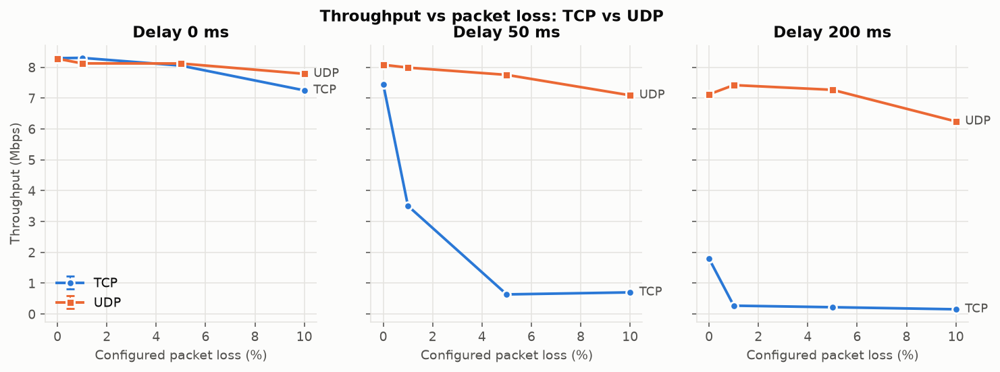

**Figure 2.** Throughput over the loss x delay grid.

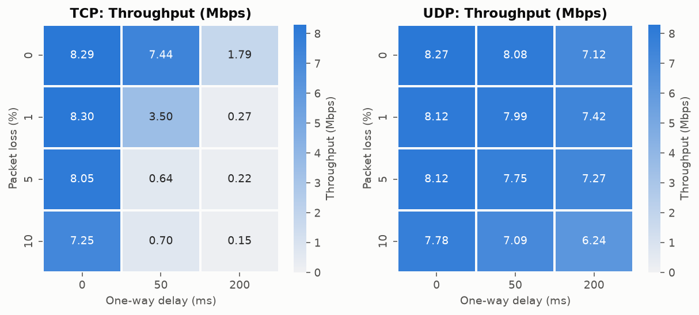

**Figure 3.** Mean RTT over the loss x delay grid.

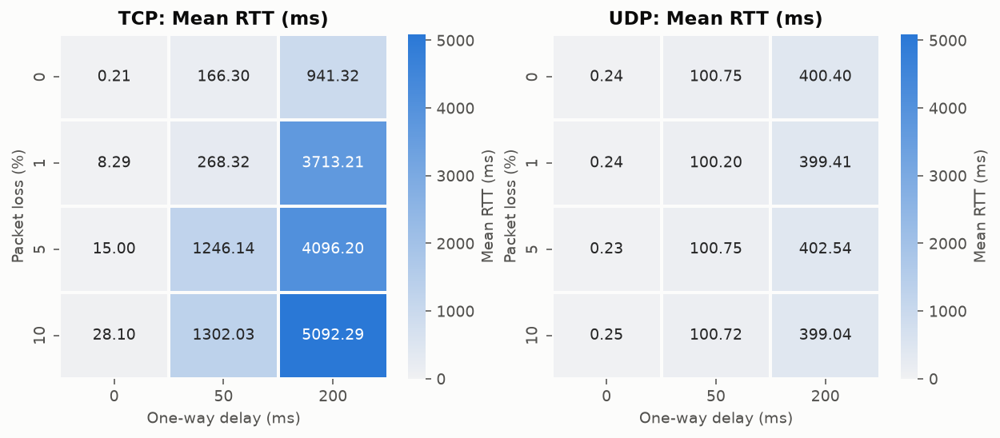

**Figure 4.** Mean RTT vs configured one-way delay (dashed: ideal 2 x delay).

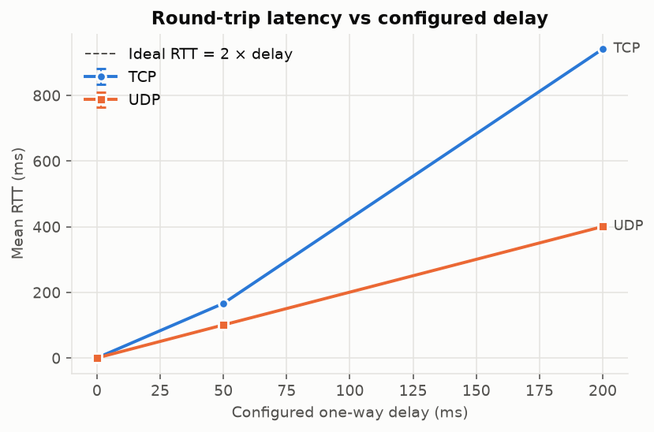

**Figure 5.** Measured loss vs configured loss.

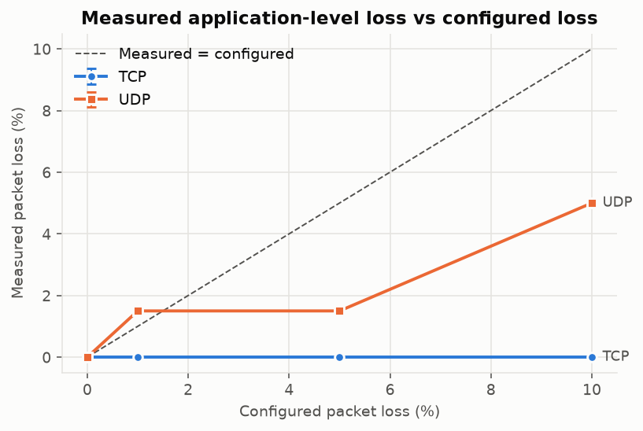

**Figure 6.** Delivery ratio by protocol and loss setting.

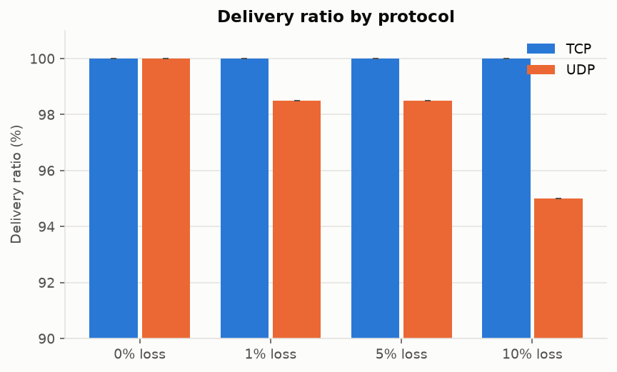

**Figure 7.** RFC 3550 jitter per condition (log scale).

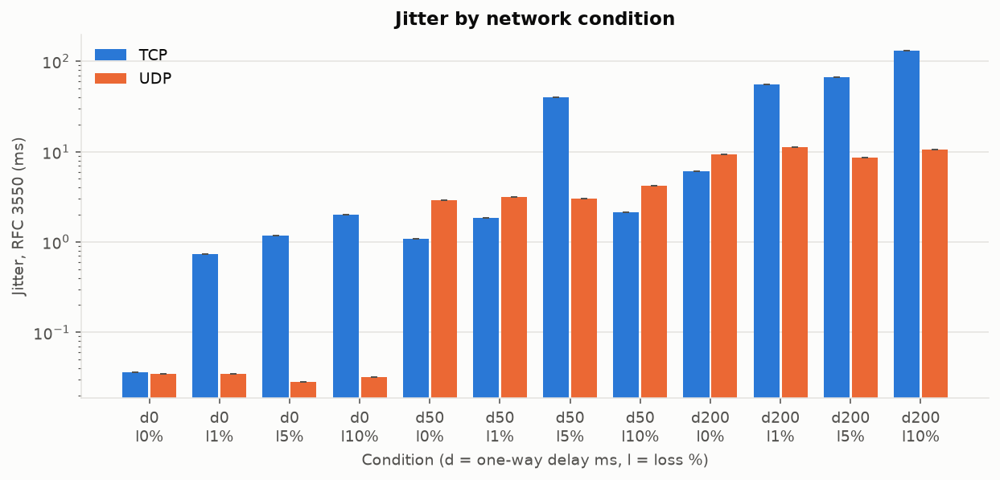

**Figure 8.** Throughput vs packet size at a fixed packet rate.

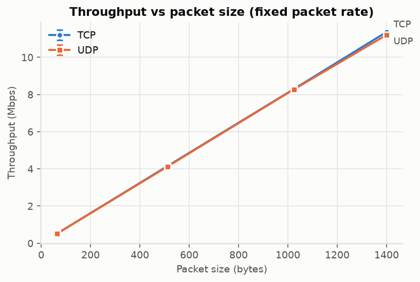

**Figure 9.** Aggregate throughput and mean RTT vs concurrent clients.

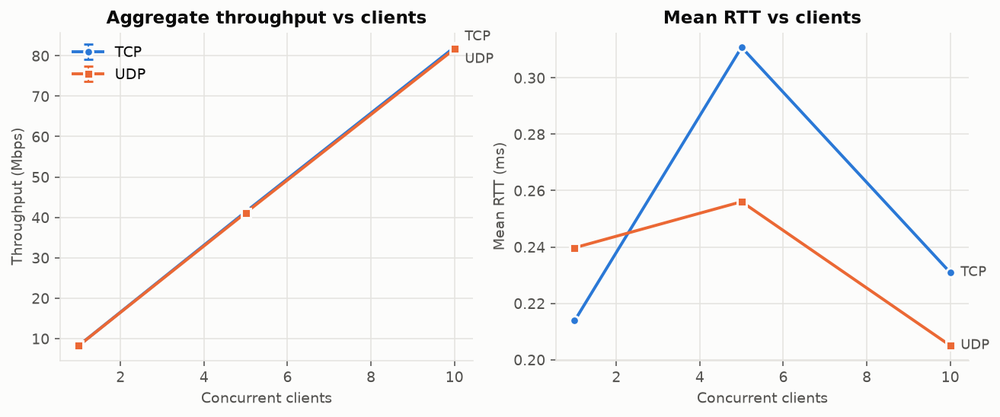

**Figure 10.** Throughput and loss under bandwidth limits.

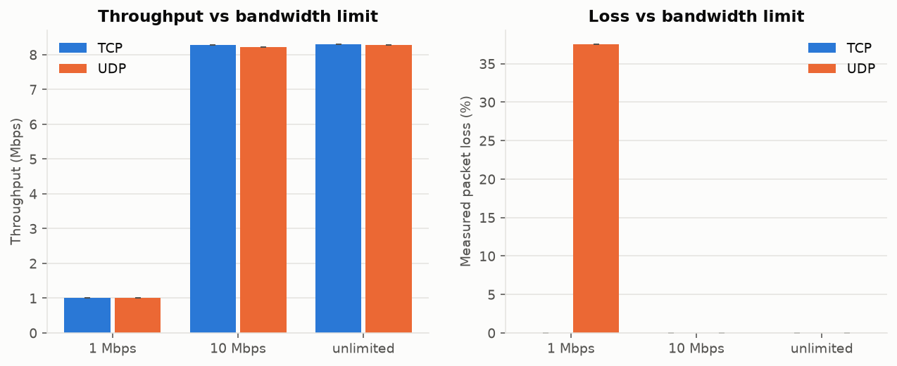

## 6. Analysis and conclusion

_Based on 855 successful runs, 855 parameter combinations, emulation mode: software._

### Headline

Across the loss x delay grid UDP wins **44** metric/condition comparisons, TCP wins **14**, and **14** are ties (within 5%). TCP always wins on **reliability** (100% delivery, in order); UDP wins on **latency, jitter and throughput as soon as the path has loss or delay**. On a clean, low-latency link the two are nearly identical.

### Where TCP throughput collapses

- **Delay 0 ms:** TCP starts at 8.29 Mbps with no loss; it never falls below 50% of that within the tested loss range (max 10%). TCP falls behind UDP from **10% loss** (7.25 vs 7.78 Mbps).
- **Delay 50 ms:** TCP starts at 7.44 Mbps with no loss; it collapses below 50% of that at **1% loss** (3.50 Mbps). TCP falls behind UDP from **0% loss** (7.44 vs 8.08 Mbps).
- **Delay 200 ms:** TCP starts at 1.79 Mbps with no loss; it collapses below 50% of that at **1% loss** (0.27 Mbps). TCP falls behind UDP from **0% loss** (1.79 vs 7.12 Mbps).
- **Delay alone (no loss):** raising delay from 0 to 200 ms changes TCP throughput 8.29 -> 1.79 Mbps (-78%) and UDP 8.27 -> 7.12 Mbps (-14%). TCP is RTT-bound (slow start, ACK clocking); UDP sends at the application's rate whatever the RTT.

### Winner per metric and condition

|   Loss % |   Delay ms | Throughput   | Mean RTT   | p95 RTT   | Jitter   | Delivery ratio   | Completion time   |
|---------:|-----------:|:-------------|:-----------|:----------|:---------|:-----------------|:------------------|
|        0 |          0 | tie          | TCP        | TCP       | tie      | tie              | TCP               |
|        0 |         50 | UDP          | UDP        | UDP       | TCP      | tie              | TCP               |
|        0 |        200 | UDP          | UDP        | UDP       | TCP      | tie              | UDP               |
|        1 |          0 | tie          | UDP        | UDP       | UDP      | tie              | TCP               |
|        1 |         50 | UDP          | UDP        | UDP       | TCP      | tie              | TCP               |
|        1 |        200 | UDP          | UDP        | UDP       | UDP      | tie              | UDP               |
|        5 |          0 | tie          | UDP        | UDP       | UDP      | tie              | TCP               |
|        5 |         50 | UDP          | UDP        | UDP       | UDP      | tie              | UDP               |
|        5 |        200 | UDP          | UDP        | UDP       | UDP      | tie              | UDP               |
|       10 |          0 | UDP          | UDP        | UDP       | UDP      | tie              | TCP               |
|       10 |         50 | UDP          | UDP        | UDP       | TCP      | TCP              | UDP               |
|       10 |        200 | UDP          | UDP        | UDP       | UDP      | TCP              | UDP               |

### UDP measured loss (%) per condition

|                |   delay 0 ms |   delay 50 ms |   delay 200 ms |
|:---------------|-------------:|--------------:|---------------:|
| 0% configured  |          0   |           0   |            0   |
| 1% configured  |          1.5 |           0   |            0.5 |
| 5% configured  |          1.5 |           3   |            4   |
| 10% configured |          5   |          13.5 |           10.5 |

UDP loss tracks the configured loss (each direction is impaired independently, so only data-direction loss counts here); TCP's measured loss is always 0% because it retransmits.

### Other findings

- **Bandwidth bottleneck (1 Mbps):** throughput is capped at the link rate (TCP 1.00 / UDP 1.01 Mbps) and the bottleneck queue inflates RTT to 787 ms (TCP) / 453 ms (UDP). UDP has no congestion control, so it kept sending above capacity and lost 37.5% of its packets to queue overflow; TCP slowed down instead and lost 0.0%.
- **Concurrency:** going from 1 to 10 clients scales aggregate throughput (TCP 8.29 -> 82.10 Mbps; UDP 8.27 -> 81.66 Mbps).
- **Packet size:** at a fixed packet rate goodput grows with size (TCP 0.40 -> 11.24 Mbps; UDP 0.39 -> 11.09 Mbps); with 64 B packets the 15 B header alone is 23% overhead (TCP adds 4 B framing).
- **Reordering:** with delay jitter UDP saw up to 159 out-of-order packets per run; TCP always delivered in order (0), at the price of head-of-line blocking.

### QoS recommendation

| Application            | Recommended   | Data-backed reason                                                                                                                                                                                                                                                              |
|:-----------------------|:--------------|:--------------------------------------------------------------------------------------------------------------------------------------------------------------------------------------------------------------------------------------------------------------------------------|
| File transfer          | TCP           | Every byte must arrive: TCP delivered 100.0% at 10% loss, UDP only 90.3%. Slower completion is acceptable.                                                                                                                                                                      |
| Web browsing           | TCP           | Pages must be complete and in order (TCP: 0 reordered/lost). Cost: TCP mean RTT 268 ms vs UDP 100 ms at 1% loss / 50 ms, so keep connections short-lived (or use QUIC: reliable streams over UDP).                                                                              |
| Video streaming (live) | UDP           | Needs steady rate more than perfection: at 5% loss / 50 ms UDP kept 7.75 of 8.08 Mbps (-4%) while TCP fell from 7.44 to 0.64 Mbps (-91%). Codecs/FEC hide the loss. (Buffered VOD often uses TCP/HTTP.)                                                                         |
| VoIP                   | UDP           | Late audio is useless: at 1% loss / 50 ms TCP p95 RTT was 396 ms vs UDP 107 ms (3.7x higher), because a lost TCP segment holds back every later packet. Jitter at 5% loss / 50 ms: TCP 39.90 ms vs UDP 3.04 ms. A few lost 20 ms frames are inaudible; concealment covers them. |
| Online gaming          | UDP           | Latency must stay low and predictable under loss: at 1% loss / 50 ms the mean RTT was TCP 268 ms vs UDP 100 ms (no head-of-line blocking); on a clean link they are comparable (TCP 0.214 / UDP 0.240 ms). Stale position updates can simply be dropped.                        |

## 7. Limitations

* **Loopback, not a real network.** All traffic stays in one host's kernel: no real NIC, switch or
  propagation delay, and impairments are synthetic (uniform random loss, no burst loss or cross traffic).
* **Software emulation is a model.** In software mode TCP loss is modelled (stall + Reno cwnd) rather than
  produced by the kernel's real congestion control (CUBIC/BBR, SACK, RTO back-off); absolute TCP numbers
  under loss are indicative, the trends are what matter. netem mode on Linux removes this limitation.
* **VM / OS noise.** Python threads, the GIL, a user-space proxy and WSL2/VM scheduling add jitter of tens to
  hundreds of microseconds and cap the packet rate; very small RTT/jitter differences are within the noise.
* **Short flows.** 200 packets per client means TCP spends much of a high-RTT run in slow
  start, which depresses its throughput relative to long bulk transfers.
* **Sender-side bufferbloat.** Clients write into large (4 MB) socket
  buffers. When the offered load exceeds a bandwidth limit, TCP data waits in those buffers and the
  application-level RTT (which starts at `send()`) includes that queueing, reaching tens of seconds at 1 Mbps.
  This is real behaviour for an application that writes faster than the path can carry.
* **Host sleep.** Runs during which the host slept are detected (wall-clock vs monotonic drift) and marked
  as errors; long matrices should run under `caffeinate` (macOS) or with sleep disabled.
* **Shared clock.** One-way delay is only meaningful because sender and receiver share a clock.
* System-wide retransmission counters (netem mode) include unrelated traffic.

## 8. Future work

* **QUIC** (e.g. `aioquic`): reliable, multiplexed streams over UDP without TCP's head-of-line blocking.
* **Congestion-control variants**: compare Reno, CUBIC and BBR (`sysctl net.ipv4.tcp_congestion_control`)
  under the same netem conditions.
* **Real multi-host tests** across Wi-Fi/LAN/WAN with PTP/NTP-synchronised clocks for one-way delay.
* Burst-loss models (Gilbert-Elliott, `netem loss gemodel`), reordering and corruption.
* Application-level QoS scores (MOS for VoIP, frame deadline misses for video and gaming).
